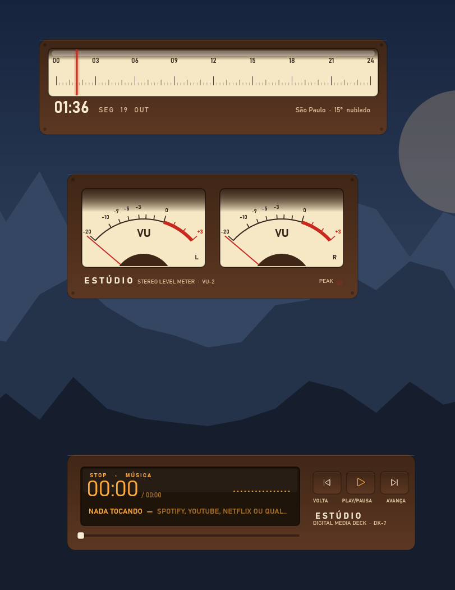
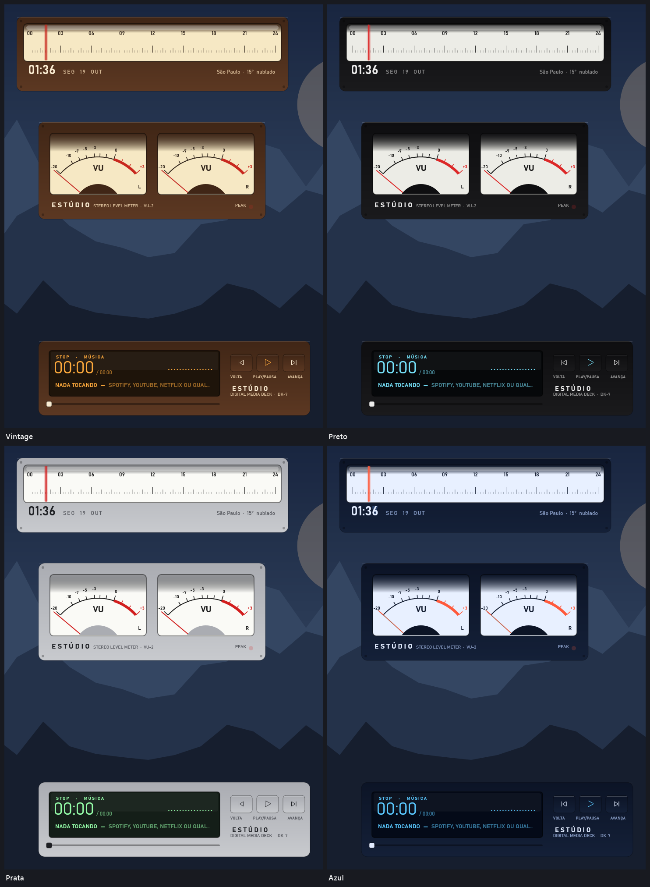
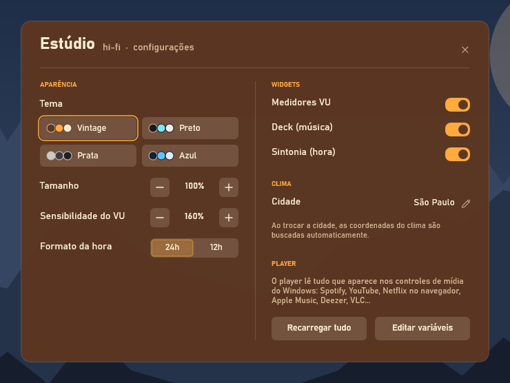

# Estúdio

**Hi-fi analógico: medidores VU, deck com LCD e dial de rádio que marca a hora.**

*Studio — Analog hi-fi: VU meters, an LCD deck and a radio dial that marks the time.*

Agora também em inglês · Now also in English · [English below](#english)

Skin para o [Rainmeter](https://www.rainmeter.net), minimalista e com tela de configurações própria.

[**⬇ Baixar Estudio.rmskin**](https://github.com/flavioferr/rainmeter-estudio/releases/latest/download/Estudio.rmskin)

## Sobre

O Estúdio traz o visual dos aparelhos de som: dois medidores VU com ponteiro reagindo ao som que toca no PC, um deck com tela de LCD e botões físicos, e um dial de rádio em que o ponteiro vermelho marca a hora do dia.

## Widgets

| Widget | O que mostra |
|---|---|
| **Medidores VU** | dois ponteiros (L e R) reagindo ao áudio, zona vermelha e luz de pico |
| **Deck** | tela de LCD com tempo grande, faixa, fonte, mini visualizador, progresso e botões |
| **Sintonia** | dial de rádio com o ponteiro na hora do dia, hora digital, data e clima |

## Temas

4 temas prontos: Vintage, Preto, Prata, Azul.

## Configurações

Clique com o botão direito em qualquer widget → **Configurações**. Tudo é salvo na hora.

- Tema (4 opções)
- Tamanho dos widgets (70% a 160%)
- Sensibilidade do VU
- Hora em 24h ou 12h
- Sua cidade (coordenadas buscadas automaticamente)
- Ligar/desligar cada widget

## Instalação

1. Instale o [Rainmeter](https://www.rainmeter.net) (4.5 ou mais novo).
2. Baixe o [`Estudio.rmskin`](https://github.com/flavioferr/rainmeter-estudio/releases/latest) na página de Releases.
3. Dê dois cliques no arquivo e clique em **Install**.
4. Na primeira vez, os widgets aparecem já posicionados e as configurações abrem sozinhas.

Prefira o `.rmskin`: ele já instala o plugin de música. A pasta [`Estudio`](Estudio) tem o código da skin.

## Dicas

- **Idioma:** botão direito em qualquer widget → **English** (ou o botão **EN** nas configurações). Para voltar, **Português**.
- **Música:** o player lê tudo que aparece nos controles de mídia do Windows — Spotify, YouTube, Netflix e qualquer site no Chrome/Edge/Firefox, Apple Music, Deezer, VLC… O plugin [WebNowPlaying](https://github.com/keifufu/WebNowPlaying-Rainmeter) (MIT) já vem dentro do `.rmskin`; a [extensão do navegador](https://wnp.keifufu.dev) é opcional. Clique na barra de progresso para pular.
- **Clima:** digite sua cidade nas configurações; as coordenadas são buscadas sozinhas (se não encontrar, tente sem acento). Os dados vêm do [Open-Meteo](https://open-meteo.com), gratuito e sem chave de API.
- **Mover:** arraste os widgets com o mouse.
- **Ajustes avançados:** o botão *Editar variáveis* abre o `@Resources/Variables.inc`.

## Requisitos

Windows 10 ou 11 e Rainmeter 4.5+. As fontes usadas já vêm com o Windows 11. Se o player ficar vazio, instale o [Microsoft Visual C++ Redistributable](https://aka.ms/vs/17/release/vc_redist.x64.exe), usado pelo plugin de música.

## Coleção

Outras skins recentes da coleção:

- [Placa](https://github.com/flavioferr/rainmeter-placa) — Letreiro de aeroporto: as letras viram quando a informação muda.
- [Brisa](https://github.com/flavioferr/rainmeter-brisa) — Aurora animada atrás dos cartões, com timer de foco (pomodoro).
- [Pulso](https://github.com/flavioferr/rainmeter-pulso) — Gráficos ao vivo: batimento sob o relógio, sistema e a onda do som.
- [Seixo](https://github.com/flavioferr/rainmeter-seixo) — Pedrinhas em tons pastel: clima desenhado, notas e sistema que enche como água.
- [Palavra](https://github.com/flavioferr/rainmeter-palavra) — Sem fundo: a hora por extenso acende numa grade de letras.
- [Constelação](https://github.com/flavioferr/rainmeter-constelacao) — Sem fundo: constelação das horas, fase da lua e um cometa para a música.
- [Origami](https://github.com/flavioferr/rainmeter-origami) — Cartões de papel dobrado: hora, clima com tsuru, música e semana.

E mais na coleção: [Lumen](https://github.com/flavioferr/rainmeter-lumen), [Horizon](https://github.com/flavioferr/rainmeter-horizon), [Orbit](https://github.com/flavioferr/rainmeter-orbit), [Shell](https://github.com/flavioferr/rainmeter-shell), [Folio](https://github.com/flavioferr/rainmeter-folio), [Bento](https://github.com/flavioferr/rainmeter-bento), [Prisma](https://github.com/flavioferr/rainmeter-prisma), [Linea](https://github.com/flavioferr/rainmeter-linea), [Pixel](https://github.com/flavioferr/rainmeter-pixel), [Soft](https://github.com/flavioferr/rainmeter-soft), [Swiss](https://github.com/flavioferr/rainmeter-swiss), [Island](https://github.com/flavioferr/rainmeter-island), [Divisa](https://github.com/flavioferr/rainmeter-divisa), [Serra](https://github.com/flavioferr/rainmeter-serra), [Mosaico](https://github.com/flavioferr/rainmeter-mosaico), [Painel](https://github.com/flavioferr/rainmeter-painel), [Eixo](https://github.com/flavioferr/rainmeter-eixo), [Maré](https://github.com/flavioferr/rainmeter-mare), [Bússola](https://github.com/flavioferr/rainmeter-bussola), [Lousa](https://github.com/flavioferr/rainmeter-lousa), [Console](https://github.com/flavioferr/rainmeter-console), [Régua](https://github.com/flavioferr/rainmeter-regua).

---

## English

**Studio** — Analog hi-fi: VU meters, an LCD deck and a radio dial that marks the time.

A minimalist skin for [Rainmeter](https://www.rainmeter.net) with its own settings screen, now in **English and Portuguese**.

### Widgets

| Widget | What it shows |
|---|---|
| **Deck** | Hi-fi deck with an LCD screen: big time, track, source, mini visualizer and buttons. |
| **Tuner** | Radio dial that marks the time of day with the red needle, plus digital time, date and weather. |
| **VU meters** | Two analog VU meters: the needles react to the sound playing on the PC. |

### Themes

4 ready-made themes: Vintage, Black, Silver, Blue.

### Installation

1. Install [Rainmeter](https://www.rainmeter.net) (4.5 or newer).
2. Download [`Estudio.rmskin`](https://github.com/flavioferr/rainmeter-estudio/releases/latest) from the Releases page.
3. Double-click the file and click **Install**.
4. Right-click any widget and choose **English**. The whole suite switches language (and back with **Português**).

### Tips

- **Settings:** right-click any widget → **Settings** (there is also an **EN/PT** button next to the close button).
- **Music:** the player reads everything in the Windows media controls — Spotify, YouTube, Netflix and any website in the browser, Apple Music, Deezer, VLC… The [WebNowPlaying](https://github.com/keifufu/WebNowPlaying-Rainmeter) plugin (MIT) is included in the `.rmskin`.
- **Weather:** type your city in the settings; the coordinates are looked up automatically. Data from [Open-Meteo](https://open-meteo.com), free and without an API key.

### Requirements

Windows 10 or 11 and Rainmeter 4.5+. If the player stays empty, install the [Microsoft Visual C++ Redistributable](https://aka.ms/vs/17/release/vc_redist.x64.exe).

### License

[CC BY-NC-SA 4.0](LICENSE.md) — use, modify and share with credit, non-commercially.

---

## Licença

[CC BY-NC-SA 4.0](LICENSE.md) — use, modifique e compartilhe, dando crédito e sem fins comerciais.
O plugin WebNowPlaying incluído no `.rmskin` é de [keifufu](https://github.com/keifufu/WebNowPlaying-Rainmeter), sob licença MIT.
